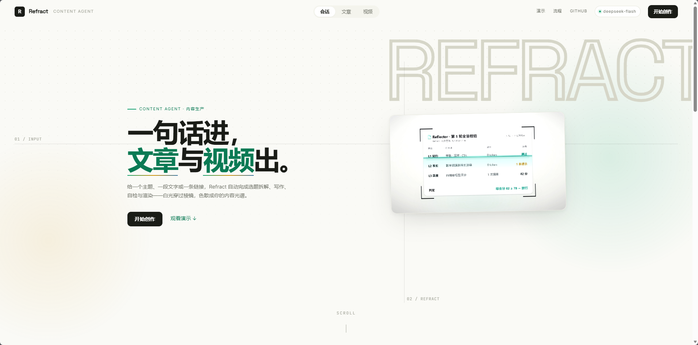
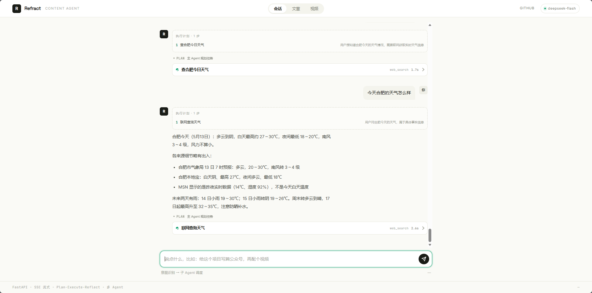
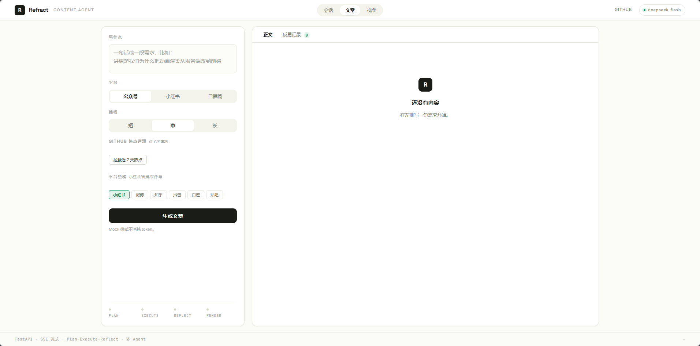
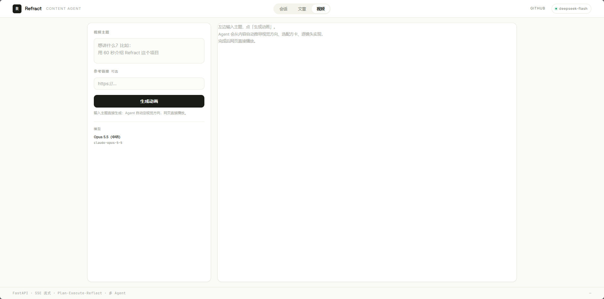

# Refract

输入一句话 / 一篇稿 / 一个链接，输出可发布的公众号文案 + 可播放的动画成品。

> 前端视觉参考企业站风格（白底 / 黑字 / 单点强调色），刻意避开"紫渐变 + 粒子 + 发光"那套 AI 产品默认皮肤。
核心是一套 **Plan → Execute → Reflect** 的编排循环：先拆成结构化方案，再按方案写，
写完全量校验，不合格时按问题严重程度决定"原样重试 / 改参数重跑 / 回退重规划"。

线上演示：`http://<服务器地址>:8080`（demo 限流，仅展示链路）



<table>
<tr>
<td width="50%"></td>
<td width="50%"></td>
</tr>
<tr>
<td><b>会话</b>：说一句话，主 Agent 自己判断该抓取、写稿还是做视频，多步任务会先列执行计划再逐步推进。</td>
<td><b>文章</b>：选平台 / 篇幅 / 选题来源，生成后可以流水式看正文，也能翻反思记录看每一轮为什么改。</td>
</tr>
<tr>
<td colspan="2"></td>
</tr>
<tr>
<td colspan="2"><b>视频</b>：输入主题直接出片。Agent 自动定视觉方向、选配方卡、逐镜头写动画代码，成品在网页里直接播放，不用下载、不用装环境。</td>
</tr>
</table>

---

## 为什么值得做

同类项目大多停在「调一次模型出文案」。真正难的是三件事，这个项目就是围绕它们做的：

1. **输入和产物都是多对多的** —— 3 种输入 × 3 种产物 = 9 条链路。
   所以第一件事不是画流程图，是定义中间表征 `ContentBrief`，下游只认它。
2. **生成结果不可信** —— 所以校验必须分层，且大部分检查不该花 token。
3. **重试会烧钱** —— 所以"怎么修"是有档位的，不能让模型一直说"再来一次"。

---

## 架构

```
输入（需求 / 文案 / 链接）
        │
        ▼
   ┌─────────────┐
   │  Planner    │  归一化成 ContentBrief（主题/角度/读者/语气/大纲/事实点/CTA）
   └─────────────┘
        │
        ▼
   ┌─────────────┐        ┌──────────────────────────────┐
   │  Executor   │───────▶│  Reflector                   │
   │  按大纲写作  │        │  L1 契约校验（不花 token）    │
   │  流式输出    │        │  L2 事实溯源（不花 token）    │
   └─────────────┘        │  L3 模型评分（唯一花钱的一层） │
        ▲                 └──────────────────────────────┘
        │                          │
        │      ┌───────────────────┼───────────────────┐
        └──────┤ retry  同参数重跑  │ refine 改参数重跑  │ replan 回退 Planner
               └───────────────────┴───────────────────┘
                                   │
                    ┌──────────────┴──────────────┐
                    ▼                             ▼
            文章产物页（/r/id）          视频播放页（/v/id/）
                                         配方卡 → 逐镜头 TSX → 闸门 → bundle
```

### 四个终止条件（少一个就会死循环或烧钱）

1. 通过：综合分 ≥ 78 且无阻断问题
2. 轮数上限（默认 2 轮）
3. 连续两轮无改进
4. 异常：降级到已产出的最高分版本

---

## 关键设计决策

### 1. ContentBrief 是契约，不是数据结构

三种输入先归一化成同一个 schema，下游 `compose / reflect / render` 都只读它。
不这么做的话，每加一种输入就要复制一遍下游逻辑。

契约不稳定，后面全是返工。所以 `app/schemas.py` 里的字段刻意保持精简（10 个）。

### 2. 校验分三层，前两层不花钱

| 层 | 检查内容 | 成本 | 能挡掉 |
|---|---|---|---|
| L1 契约 | 字数偏离、漏节、缺 CTA | 0 | 大部分低级错误 |
| L2 事实 | 正文里的数字能否在事实清单找到出处 | 0 | 编造数据 |
| L3 质量 | 模型按 4 个维度打分 + 指出具体问题 | 一次调用 | 结构松散、语气跑偏 |

很多项目一上来就全交给模型打分，问题和钱都花在第三层。

### 3. `repair_action` 由代码判定，不由模型给

模型只负责"指出问题"，"该重试还是该重新规划"是成本决策。
交给模型会得到一个永远说 `refine` 的复读机。

```python
if total < 55 or blocking >= 2:  return "replan"
if blocking >= 1 or total < 78:  return "refine"
return "pass"
```

**阈值是实测校准出来的，不是拍的。** 第一版按 62/82 设，
真实模型把正常稿子打成 `replan`，每篇多付一次规划成本，耗时从 30 秒涨到 115 秒。

### 4. 阻断 vs 提示：误报率高的规则不能做阻断

第一版把"数字找不到出处"当阻断条件，结果正文里"三步""5 分钟"这类常规表述全被命中，
一次报 6 条，把 75 分的稿子打成 `replan`。

现在 `lint()` 返回 `(问题, 是否阻断)`，规则按误报率分级：
字数离谱、大面积漏节算阻断；缺 CTA、数字无出处只做提示。

### 5. 反思是非关键路径，失败不能拖死主流程

第 2 轮反思时模型偶尔输出非法 JSON（尾逗号、包了代码围栏），
第一版直接抛异常，整篇稿子作废。现在：

- `loads_loose()` 先做宽松解析（去围栏、修尾逗号），0 成本
- 仍失败则降级为纯规则校验，把"评分模型不可用"写进 issues，继续往下走

关键路径和非关键路径必须区别对待，这是可用性问题，不是容错技巧。

### 6. 推理模型的 `max_tokens` 要单独算

`deepseek-flash` 是推理模型，响应里带 `reasoning_content`，**推理 token 和正文共用额度**。
额度给少了会把 JSON 拦腰截断（实测 `finish_reason=length`）。

处理：检测 `finish_reason=length` 时放大 1.7 倍重试，而不是把半截 JSON 塞回去让模型"修格式"。

### 7. 最后一版 ≠ 最好的一版

实测第 2 轮（修订轮）经常反而更差：字数膨胀到 3 倍、语气走样。
所以最终产物取**历史最高分**那一轮，并在结果里记录 `kept_round`。

### 8. 产物是网页，不是 mp4

服务器只有 1.9G 内存，Remotion 要拉 Chromium，峰值 2–4G，一跑就 OOM。

所以交付形态是**网页**：Remotion 工程在服务端 bundle 成静态站点，
前端用 `@remotion/player` 渲染，用户打开链接就是自动播放的片子——
秒开、可暂停、可拖进度、清晰度无损，不用下载、不用装环境。
要发平台时再在本地离线导出 mp4。

bundle 是一次性构建（约 30 秒，峰值内存 500MB），产物按任务缓存，
`/v/{task_id}/` 直接托管。构建失败不阻断主流程，降级到带镜头表的信息页。

### 9. 不同活派给不同模型，且能运行时切换

不是所有活都值得用最贵的模型。这里按**用途**路由，而不是全局一个模型：

| 用途 | 干什么 | 模型 | 理由 |
|---|---|---|---|
| `text` | 拆方案 / 写正文 / 打分 / 推荐视觉方向 | DeepSeek flash | 调用频次高、输出短，要快 |
| `video` | 逐镜头写 Remotion 组件 | Opus 5.5（中转） | 每镜几百行 TSX + 视觉理解，弱模型写不完整 |

实现上是一张可运行时修改的路由表（`app/models.py`），落盘到 `data/models.json`：

```
GET  /api/models          看当前哪类活用哪个模型、凭据有没有配好
POST /api/models/route    改路由，立即生效，不重启进程
```

**跨协议**是这里的真问题。DeepSeek 走 OpenAI 的 `/chat/completions`（Bearer），
Claude 走 Anthropic 的 `/v1/messages`（system 是顶层字段、没有 `response_format`、
截断信号是 `stop_reason=max_tokens` 而非 `finish_reason=length`）。
两套协议封在同一个 `LLMClient` 后面，调用方只写 `route="video"`。

**降级链是硬要求，不是优化**：`video` 默认 `[cctq, deepseek-chat]`。
中转站挂了、key 被限流、请求超时，都会自动顺着链换下一个 provider——
宁可出一版差的，不能整条链路断掉。

但降级**必须让用户看见**：首选模型不可用时画面质量会明显不一样，
静默降级只会让用户觉得「这次怎么变丑了」。所以降级信息用 `contextvars` 记录
（并发请求之间不会串），随 SSE 推到前端，界面直接提示
「Opus 5.5（中转）当前不可用，已降级为 DeepSeek（代码）生成」，
留痕里记的也是**实际使用**的模型，不是配置值。

### 10. 视频：配方卡约束 + 逐镜头生成 + 闸门兜底

让模型"自由发挥一整份动画"不可控——方向飘、风格乱、代码还经常跑不起来。
这里把"动效设计"提前固化：124 张配方卡（每张是一种镜头范式，带时长 / 能量 / 适用场景），
模型只做两件事：**选卡**（内容 → 镜头序列）和**填卡**（照着卡写这一个镜头的组件）。

管线分四段：

| 阶段 | 干什么 | 失败怎么办 |
|---|---|---|
| 选卡 | 按内容简报映射 5~8 张卡，排出能量曲线 | 编造的卡名直接丢弃，宁缺毋滥 |
| 逐镜头 | 每镜生成一个 TSX 组件（约 4k token） | 过不了闸就带着具体原因重写一次，仍不过落模板 |
| 组装 | 确定性拼 Root / 时序 / 音轨；音效与画面同源 mulberry32 | 工程级硬伤 → 整片降级模板 |
| 打包 | bundle 成静态站点，用 `@remotion/player` 播放 | 失败降级信息页，不阻断主流程 |

闸门分两级共 15 项，**全是确定性检查，不花 token**：

**逐镜头（9 项）**：长度够、括号配对、有 `export default`、用了 `useCurrentFrame`、
不含不确定调用（`Math.random` / `Date.now` / 定时器 / `fetch`）、
import 在白名单内、有文案、真的渲染了镜头文字、props 解构完整。

**工程级（6 项）**：镜头文件齐全、lib 组件在位、Root 正确注册、
每个镜头都挂上了 Sequence、有音轨、JSX 属性带花括号。

闸门不追求"好看"，只保证"不是废片"——宁可给 70 分的模板片，也不给 0 分的黑屏。
每个镜头的尝试记录（第几版、为什么没过）都会回传，前端能看到哪几镜是落模板的。

### 记忆分三层，各管各的

踩过的坑：只存「上一轮拉了微博 top10」这种摘要，用户追问「详细讲一下第二条」，
模型手上一个标题都没有，只能答找不到。所以三层分开存：

| 层 | 存什么 | 实现 | 为什么不用向量库 |
|---|---|---|---|
| 工作记忆 | 热榜 10 条（含排名/热度/链接）、搜过的词、产物链接 | `agents/session_context.py`，JSON 落盘 `data/sessions/` | 这是**结构化数据**，被「抽取成事实」后条目和链接全丢，正是要修的 bug |
| 对话记忆 | 最近 5 轮原文 + 更早的滚动摘要 | 同上 | 摘要已经够用，不进向量库 |
| 长期记忆 | 跨会话的用户事实与偏好（"他做自媒体，小红书要口语化"） | `agents/long_memory.py` 适配 **mem0**（可选） | 这类才需要语义检索，用现成模块 |

长期记忆**默认关闭**：mem0 必须要 embedding（向量化）模型，而 DeepSeek 没有 embedding
接口。三条路实测——fastembed 本地 ONNX 模型在这网络下下载要 12 分钟（直连 HuggingFace
直接超时）、sentence-transformers 要 torch（2G 内存机器判死）、硅基流动 API 免费但要 key。
开了 key 就能用（服务器上已开）：

```bash
uv pip install --python .venv/bin/python mem0ai   # 17 个包，不降级现有依赖
# .env
MEM0_ENABLED=1
MEM0_EMBED_KEY=sk-xxx                # 硅基流动，bge-m3 免费
MEM0_EMBED_BASE=https://api.siliconflow.cn/v1
MEM0_EMBED_MODEL=BAAI/bge-m3
MEM0_EMBED_DIMS=1024                 # bge-m3 是 1024 维，必须显式给
```

`/api/health` 的 `memory` 字段会直接告诉你开没开、初始化成功没有、失败原因。

实测（2026-11-02，服务器真跑）：写入 1.4~2.2s（DeepSeek 抽事实），检索 0.2s，
跨会话跨网络召回准确，用户之间隔离。存进去的是「用户叫小梁，做自媒体」这类事实，
132KB。

**接 mem0 踩的四个坑**（都在 `long_memory.py` 注释里）：
1. `embedding_model_dims` 必须显式给。mem0 认不出我们用 OpenAI 兼容协议指向的
   第三方模型，默认按 ada-002 建 1536 维的库，bge-m3 是 1024 维，写入就报
   `shapes (0,1536) and (1024,) not aligned`
2. mem0 2.2 改了检索签名：`user_id` 不能放顶层，得 `search(filters={"user_id": ...})`，
   代码里两种都试一遍，换版本不至于哑掉
3. 本地 qdrant 是**单进程文件锁**：服务占着 `data/mem0` 时，任何调试脚本都打不开
   （报 already accessed by another instance）。要查库就 `cp -r data/mem0 /tmp/x` 再开副本
4. 只喂**用户的话**给 mem0，别喂助手答复。实测一起喂会把助手自己编的建议抽成
   「用户的偏好」存下来，越存越歪

**长期记忆挂 `user_key` 不挂 `session_id`**：session_id 是 IP 派生的，换 Wi-Fi 就变，
记忆会断。前端 localStorage 存一个 uuid（web/app.js 的 `userKey()`）随请求带上，
后端 `user_key or session_id`。


---

### 账号：邮箱验证码，历史跟着人走

最早用「IP 派生 session_id」认人，结果是：换 Wi-Fi 就换身份、同办公室互相串、
手机和电脑不同步，用户看到的现象是「有时进主页、有时进一张空白聊天页」——
因为前端靠本机 localStorage 里那个 IP 派生的 id 判断有没有历史，和服务端记的对不上。

现在改成账号：

- **登录**：邮箱 + 6 位验证码，第一次登录自动建账号，没有单独的注册流程。
  验证码 5 分钟有效、一次性、同邮箱 60 秒 1 封 / 每小时 5 封、错 5 次作废
- **会话列表**：`conversations` 表，一个账号多条会话，标题取第一句话，
  按最近活跃排序。历史仍按会话存文件（`data/sessions/{cid}.json`）
- **身份落在 Cookie**：`refract_auth`（HttpOnly，XSS 偷不到）+ `refract_seen`
  （非 HttpOnly，只给首屏内联脚本判断「这人登录过」，避免刷新闪一下落地页）
- **配额、长期记忆都挂账号**：换设备也认你；`user_id` 取代 `user_key`

```bash
# .env（QQ 邮箱为例，授权码不是登录密码）
SMTP_HOST=smtp.qq.com
SMTP_PORT=465
SMTP_USER=you@qq.com
SMTP_PASS=xxxxxxxxxxxxxxxx      # QQ 邮箱「设置 → 账户 → 生成授权码」
```

没配 SMTP 时，`/api/auth/send-code` 会明确报「服务器还没配发件邮箱」，
不会假装发出去了。本地开发可以 `AUTH_DEV_CODE=1`，验证码直接回给前端、自动填进输入框。

## 快速开始

```bash
python -m venv .venv
.venv\Scripts\activate          # Linux/macOS: source .venv/bin/activate
pip install -r requirements.txt

# Mock 模式（默认，不消耗 token）
python -m uvicorn app.main:app --reload --port 8000

# 真实模型
set DEEPSEEK_API_KEY=sk-xxx     # Linux/macOS: export DEEPSEEK_API_KEY=sk-xxx
set LLM_MOCK=0
python -m uvicorn app.main:app --reload --port 8000
```

Windows 可以用 `.\run.ps1` / `.\run.ps1 -Real`（自动从系统环境变量读 key）。

打开 http://127.0.0.1:8000

### 自检

```bash
python tests/smoke.py                          # 端到端：起任务 → 读 SSE → 查产物
python tests/preview.py                        # 离线生成 demo 产物，看视觉
# 产物页加 ?static=1 关掉动画看布局，?scene=N 直接看第 N 个场景
```

---

## 目录

```
app/
  config.py          运行模式与数据目录（模型选择不在这里）
  models.py          模型路由表：用途 → provider 链，可运行时切换
  schemas.py         ContentBrief 等契约
  llm.py             双协议客户端：OpenAI 兼容 + Anthropic，结构化/流式/长文本
  mock.py            Mock 数据源（结构与真实调用完全一致）
  agents/            子 Agent 分工：intent / orchestrator / researcher / writer / director
    supervisor.py    对话主 Agent：规则层 → 规划层（模型决定用哪些工具）→ 执行层
    session_context.py 会话状态：热榜条目/搜过的词/产物 + 最近 5 轮 + 早期摘要（落盘）
    long_memory.py   长期语义记忆适配层（mem0，可选；没配 embedding key 自动关闭）
    memory_keeper.py 人设/偏好读写门面（SQLite）
  pipeline/
    brief.py         Planner
    compose.py       Executor
    reflect.py       Reflector（三层校验 + 三档决策）
    engine.py        plan-execute-reflect 循环
    fetch.py         链接抓取（trafilatura + SSRF 防护）
    memory.py        三层记忆：会话 / 项目 / 长期结构
    director.py      三套视频方案推荐
    recipes.py       video-shotcraft 配方卡索引（124 张，frontmatter 解析）
    remotion_video.py 视频方案 v2：选卡分镜 → 逐镜头 TSX → Remotion 工程拼装 + 闸门
    sfx.py           SFX 本地确定性合成（wav，与画面同源 mulberry32）
    opus_video.py    [legacy] 整份动画 HTML 生成（已被 remotion_video 替代）
    video.py         模板渲染（降级路径）
    renderer.py      文章产物渲染
  main.py            FastAPI：SSE、任务、产物、模型路由
mcp_server.py        10 个 MCP tool（抓取/热榜/搜索/文案/视频/记忆），供外部 AI 客户端调用
web/                 前端（原生 JS，无构建步骤，四个板块：会话/文章/视频/演示）
  index.html         主页面
  app.js             全部前端逻辑（板块切换、SSE 渲染、任务流）
  styles.css         样式（主题色在 :root 的 CSS 变量）
docs/screenshots/    界面截图
tests/
  smoke.py           端到端冒烟
  video_probe.py     [legacy] 旧视频链路探针
  remotion_probe.py  Remotion 管线真实模型探针（DeepSeek 跑通 → 完整工程）
  test_remotion.py   管线单测：闸门/SFX/映射校验/mock 全链路
  preview.py         离线产物预览
```

视频产物形态：**Remotion 工程 + 服务端 bundle 的播放页**（不出 mp4）。
`/v/{task_id}/` 打开就是自动播放的成片；bundle 失败则降级到带镜头表的信息页。
模型路由：本地测试用 deepseek-chat（逐镜头生成，8k token 内），
配好 CCTQ 凭据后自动切 Opus（`data/models.json` 路由表，代码零改动）。

---

## API

| 方法 | 路径 | 说明 |
|---|---|---|
| POST | `/api/chat` | 对话入口 `{input, session_id?}` → `{task_id}`，主 Agent 接管 |
| POST | `/api/generate` | 文章 `{input, url?, platform, style?, words?}` → `{task_id}` |
| POST | `/api/video/render` | 视频 `{input, url?, platform, words?, plan?}` → `{task_id}` |
| GET | `/api/tasks/{id}/events` | SSE 事件流 |
| GET | `/api/tasks/{id}` | 任务快照 |
| GET | `/r/{id}` | 文章产物页 |
| GET | `/v/{id}/` | 视频播放页（bundle 产物；构建失败降级信息页） |
| GET | `/api/health` | 健康检查 + 当前模式 + 各用途用的模型 |
| GET | `/api/models` | 模型路由快照（含凭据是否配好、实际是否降级） |
| POST | `/api/models/route` | `{route, chain}` 运行时切换模型 |
| POST | `/api/fetch` | 抓链接预览正文 |
| POST | `/api/intent` | 只识别意图不执行 |
| GET | `/api/hot/{source}` | 平台热榜（rednote/weibo/zhihu/douyin/baidu/tieba） |
| GET | `/api/trending/github` | GitHub 趋势 |
| GET | `/api/runs` | 生成记录列表 |
| GET | `/api/styles` | 视频风格库 |
| GET/POST/DELETE | `/api/memory` | 项目记忆读写 |

SSE 事件：`stage / plan / step_start / step_end / tool_detail / delta / reflection / artifact / video / gate / fallback / decision / note / done_reply / done / error / ping`

`decision` 是「模型这一步的判断」：视频的内容简报、剧本（每个镜头的卡/时长/屏幕文字）、选卡、闸门拦截、落模板原因，全部原样推给前端，用户在视频面板里能回看每一步。

`delta` 分 `kind=reasoning`（推理过程，前端显示"思考中"）和 `kind=content`（正文，流式渲染）。

`gate` 是视频闸门结果：`{ok, failures, stats, attempts, model, fallback}`。
其中 `attempts` 是**逐镜头尝试明细**（数组），`failures` 是没过闸的具体原因。

`fallback` 是模型降级通知：`{from, to, from_model, to_model, reason}`——
首选模型不可用、已切后备时推送，前端据此显示「XX 不可用，已降级为 YY」。

---

## 已知限制

- 任务状态在进程内存里。单机演示够用，多实例要换 Redis Stream（接口不用动）
- 视频闸门只保证「不是废片」，不保证好看；质量上限仍取决于视频模型
- 反思的评分器没有用标注样本校准，L3 分数只能做相对比较
- 产物页是 16:9 横屏，竖屏版需要重排布局
- 中转站的模型名需与账号可用模型一致（`CCTQ_MODEL`，默认 `claude-opus-5-5`）
- **内存要留够**：bundle 时 node 峰值约 500MB，加上 Python 主进程总共 850MB 左右。
  systemd 的 `MemoryHigh` 压到 560M 会让 node 被反复 throttle、打包静默失败，
  视频只好降级成信息页。现在配的是 1000M / 1200M。
- 中转站的 key 可能被限流或停用分组，届时 `video` 路由会降级到 DeepSeek（质量弱一档），
  前端会明确提示，不会静默降级

---

## License

仅用于个人项目演示。
